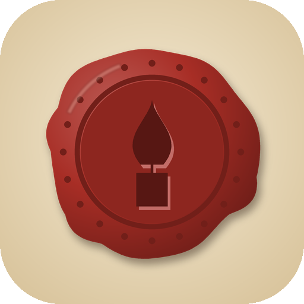
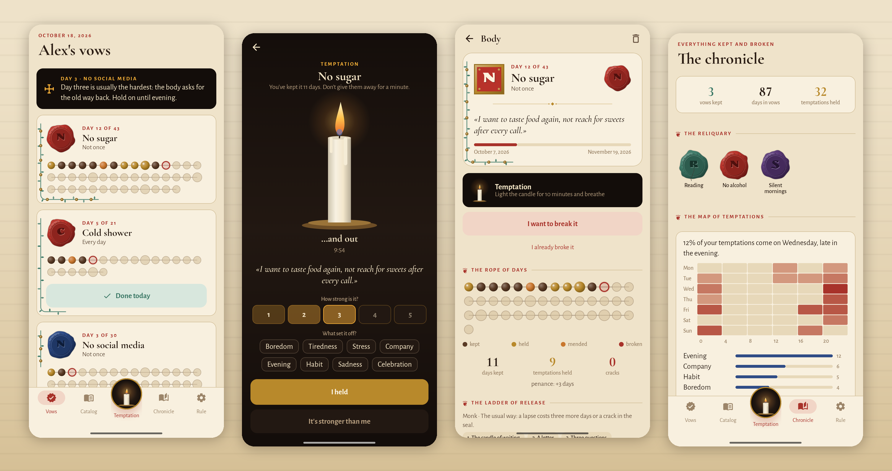

<div align="center">



# Vigil

### Make a vow. Seal it with wax. The seal can be broken, but not easily.

*An app for vows of abstinence and practice: no sugar, a cold shower, mornings without a phone. Choose how long, when it begins and what stands between you and breaking it. Free, no ads, no account, no network.*

[](https://github.com/bigdevwhale/vigil/actions/workflows/android.yml)
[](https://github.com/bigdevwhale/vigil/releases/latest)


[](LICENSE)

**English** · [Русский](README.ru.md) · [Changelog](CHANGELOG.md)



</div>

---

## The idea

A vow is a scroll in a scriptorium. You write it, press the wax, and a candle is lit. Every day kept is a bead on your prayer rope and a leaf on the vine around the page. When the vow is kept, the page is fully illuminated and its seal goes to the reliquary.

Breaking it is allowed, but you climb down a **ladder of release** you built yourself when you sealed it. At any step you may still hold on.

## Making a vow

| | | |
|---|---|---|
| **What** | from the catalog (70 vows in seven parts) or your own | abstain · practice (ticked off daily) · a measure ("one cup a day") · hours ("no phone 22:00–7:00") |
| **How long** | 3, 7, 21, 40, 49, 108 days, your own, or no end | each traditional number explained: forty is a fast, 108 a round of the rope |
| **When** | now · at dawn tomorrow · after the last supper · on a day you choose | until then the vow is "bound" and counts down |
| **Why** | in your own words, and in your own voice | the recording plays when temptation comes |
| **Rigor** | Novice · Monk · Hermit | decides what a broken vow can become |
| **Testament** | a letter to yourself | sealed until the day the vow is kept |
| **Seal** | wax colour and an illuminated initial | hold the wax until the seal sets |

## The ladder of release

| Step | |
|---|---|
| 🕯 **The candle of waiting** | a candle burns down (5 to 120 minutes) before you can go on |
| 🎙 **Your voice** | your recorded reason, played to the end |
| ✉ **A letter** | write why you're breaking it, at least N letters; it stays in the chronicle |
| ❓ **Three questions** | how will you feel in an hour, what is this really about, what would you tell a friend |
| ⚜ **Ransom** | an act that buys the vow back: 30 squats, a walk outside |
| 👤 **A witness** | a ready message to someone you chose, by SMS or any messenger |
| ⚖ **A tithe** | what you pledged becomes a debt in the chronicle |
| 🌙 **Sleep on it** | breaking is allowed only tomorrow, from an hour chosen in advance; in the morning the app asks again |

Broken anyway? **Indulgence** (novices, one in ten days), **penance** (the vow grows longer), **a crack** (the seal keeps it for good) or **burning** (the scroll goes to the chronicle unfinished). A hermit's vow can only burn, and can be begun again at once.

## When temptation comes

The candle button in the middle of the bar opens the night: a candle burns for ten minutes (you can change it), the flame swells as you breathe in for four and out for six, your reason and your voice are there. Say how strong it is and what set it off. Every temptation held is a **gold bead** on the rope.

## And also

- **The evening examen:** kept, hard, or broken, in one tap.
- **The morning rule:** today's vows, with a warning on the hard days (3, 7, 14, 21, 30, 40).
- **The map of temptations:** weekday by time of day, the usual triggers, how many were held.
- **Seasons:** Sober October, Dry January, Lent (Orthodox or Western, computed), the Nativity Fast, No-spend November, offered two weeks ahead.
- **Lineage:** a kept vow suggests its next step (no sugar 21 → no snacking; meditation 21 → 108).
- **The rule of three:** no more than three vows at once.
- **The candle widget** on the home screen.
- **The chronicle:** the reliquary of seals, letters, tithes to settle, and the book of hours.

## Privacy

No account, no analytics, no ads, no network permission. Vows, letters and voice recordings stay in the app's own storage.

## Build

```bash
./gradlew assembleDebug                 # app.vigil.dev, next to a real install
./gradlew assembleDebug -Pdemo          # app.vigil.demo with a made-up summer of vows
./gradlew testDebugUnitTest -Prender    # paints the screens to app/build/art
python tools/icon.py                    # repaints the icon
```

Kotlin, Jetpack Compose, Room, DataStore. The seals, candles, beads and illumination are drawn in code (`ui/components/Art.kt`). Fonts: Cormorant Garamond, Alegreya Sans and Ruslan Display (SIL Open Font License).

## License

[MIT](LICENSE) · part of [Stillcraft](https://bigdevwhale.github.io/stillcraft/)
