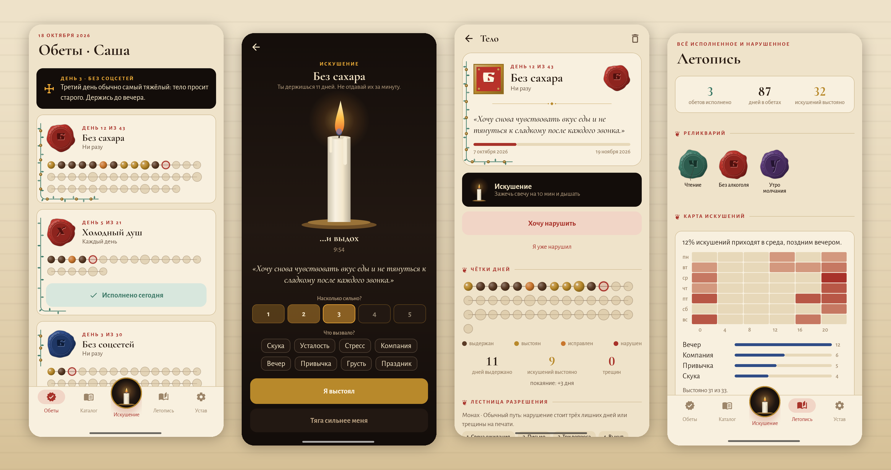

# Обет · Vigil

### Дай обет. Запечатай воском. Сломать печать можно — но не легко.

*Приложение для аскез: без сахара, холодный душ, утро без телефона. Выбери срок, час начала и то, что встанет между тобой и нарушением. Бесплатно, без рекламы, без аккаунта, без сети.*

[English](README.md) · **Русский** · [Изменения](CHANGELOG.md)

---

## Идея

Обет — это свиток в скриптории. Ты пишешь его, прижимаешь сургуч, и загорается свеча. Каждый выдержанный день — бусина на чётках и лист на лозе вокруг страницы. Когда обет исполнен, страница расписана целиком, а печать ложится в реликварий.

Нарушить можно, но сначала придётся спуститься по **лестнице разрешения**, которую ты строишь, запечатывая обет. На любой ступени ещё можно выстоять.

## Устав обета

| | | |
|---|---|---|
| **Что** | из каталога (70 обетов в семи разделах) или свой | воздержание · практика (отмечается каждый день) · мера («одна чашка в день») · часы («без телефона 22:00–7:00») |
| **Срок** | 3, 7, 21, 40, 49, 108 дней, свой или без срока | у каждого традиционного числа есть объяснение: сорок — пост, 108 — круг чёток |
| **Начало** | сейчас · завтра на рассвете · после последнего ужина · в выбранный день | до начала обет «связан» и ведёт обратный отсчёт |
| **Зачем** | своими словами и своим голосом | запись звучит в минуту искушения |
| **Строгость** | Послушник · Монах · Отшельник | решает, чем может стать нарушенный обет |
| **Завещание** | письмо себе | запечатано до дня, когда обет исполнится |
| **Печать** | цвет сургуча и буквица | держи сургуч, пока печать не встанет |

## Лестница разрешения

| Ступень | |
|---|---|
| 🕯 **Свеча ожидания** | свеча догорает (от 5 до 120 минут), прежде чем можно идти дальше |
| 🎙 **Твой голос** | записанная причина, до конца |
| ✉ **Письмо** | напиши, почему нарушаешь, не меньше N знаков; письмо остаётся в летописи |
| ❓ **Три вопроса** | что почувствуешь через час, о чём это на самом деле, что ответить другу на твоём месте |
| ⚜ **Выкуп** | поступок, которым обет выкупается: 30 приседаний, выйти на улицу |
| 👤 **Поручитель** | готовое сообщение выбранному человеку по SMS или в любой мессенджер |
| ⚖ **Десятина** | обещанное становится долгом в летописи |
| 🌙 **Утро вечера мудренее** | нарушить можно только завтра, с заранее выбранного часа; утром приложение спросит ещё раз |

Обет всё-таки нарушен? **Индульгенция** (послушникам, одна на десять дней), **покаяние** (обет становится длиннее), **трещина** (печать хранит её навсегда) или **сожжение** (свиток уходит в летопись незавершённым). Обет отшельника может только сгореть — и сразу начаться заново.

## Когда приходит искушение

Кнопка-свеча в центре панели открывает ночь: свеча горит десять минут (можно изменить), пламя растёт на вдохе в четыре счёта и опадает на выдохе в шесть, рядом твоя причина и твой голос. Отметь силу тяги и что её вызвало. Каждое выстоянное искушение — **золотая бусина** на чётках.

## А ещё

- **Вечерний экзамен:** выдержан, было трудно или нарушен — в одно касание.
- **Утреннее правило:** обеты на сегодня и предупреждение в трудные дни (3, 7, 14, 21, 30, 40).
- **Карта искушений:** дни недели по времени суток, частые триггеры, сколько выстояно.
- **Сезоны:** трезвый октябрь, трезвый январь, Великий пост (православная или западная Пасха — считается), Рождественский пост, ноябрь без покупок — за две недели до начала.
- **Преемственность:** исполненный обет предлагает следующую ступень.
- **Правило трёх:** не больше трёх обетов сразу.
- **Виджет-свеча** на главном экране.
- **Летопись:** реликварий печатей, письма, десятины к уплате и часослов.

## Приватность

Без аккаунта, аналитики, рекламы и разрешения на сеть. Обеты, письма и записи голоса хранятся только в приложении. Подробно — в [политике конфиденциальности](PRIVACY.md).

## Лицензия

[MIT](LICENSE) · часть [Stillcraft](https://bigdevwhale.github.io/stillcraft/)
